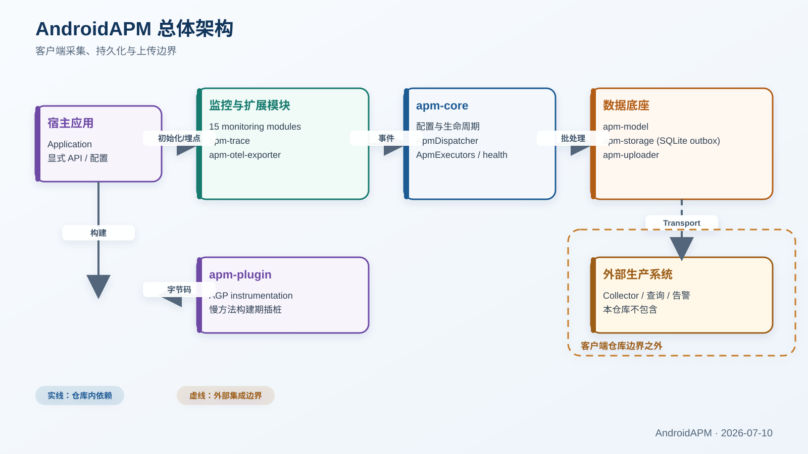

# Android APM Framework

[](LICENSE)
[](docs/Android_APM_项目文档.md)
[](#当前基线)
[](#当前基线)
[](#当前基线)

模块化的 Android 应用性能监控（APM）客户端 SDK：15 个监控模块加 5 个基础模块，用单个 `apm-bundle` 坐标即可获得完整端上能力。

默认行为面向生产——`PRODUCTION_STRICT` fail-closed 配置、显式同意与撤回清理、稳定事件身份、SQLite durable outbox、并发上传租约、动态短期鉴权、Ed25519 签名远程配置、批量 HTTP 传输，以及独立于事件链路的 SDK 自诊断日志。

> **范围**：本仓库只负责 Android 端的采集、保护、持久化与传输。生产 Collector、查询/告警后台、Native 符号化服务和托管平台不在本仓库，统一由独立 `AndroidAPM-Server` 仓库维护。

## 目录

- [核心能力](#核心能力)
- [当前基线](#当前基线)
- [架构与关键不变量](#架构与关键不变量)
- [模块组成](#模块组成)
- [快速接入](#快速接入)
- [关键默认值](#关键默认值)
- [定位对比](#定位对比)
- [SDK 自诊断](#sdk-自诊断)
- [构建与验证](#构建与验证)
- [完成边界](#完成边界)
- [参与开发](#参与开发)
- [文档](#文档)
- [License](#license)

## 核心能力

- **采集覆盖**：启动、卡顿、内存、崩溃、ANR、网络、IO、SQLite、WebView、IPC、线程、GC、电量与渲染，共 15 个模块，按需注册。
- **传输可靠**：稳定 `eventId` 贯穿全链路，SQLite durable outbox v4 持久化，claim/lease/expiry 支持多进程并发上传，上传成功才删除。语义是 at-least-once，服务端按 `eventId` 幂等去重。
- **生产合规**：`PRODUCTION_STRICT` 在创建任何运行时资源前 fail-closed 校验；默认 PII 脱敏；同意撤回是隐私关闭而非优雅关闭；长期密钥不进 APK。
- **开销受控**：入口有界队列（条数 + 估算字节）、模块级高水位隔离、单 worker 有序管线、固定阶段尾延迟证据、带迟滞的 AutoThrottle。
- **可运维**：独立本地诊断 journal 与 ZIP 导出、`sdk_health` 双通道、按稳定 reason 归因的丢弃计数，以及 codec/SQLite/dispatcher 的固定性能预算。

## 当前基线

基线日期：2026-11-08。

| 项 | 值 |
|---|---|
| SDK 版本 | `0.1.0` |
| 构建链 | Gradle 9.6.0 / AGP 9.5.1 / Kotlin 2.2.21（AGP 内置 Kotlin）/ Java 17 toolchain |
| Android | compileSdk 36 / minSdk 24 / targetSdk 34，Java 17 字节码 |
| 消费方下限 | AAR 元数据 `minCompileSdk=36`；`com.apm:apm-plugin` 随附 AGP 9.5.1 → 接入方须 AGP 9.x |
| 规模 | 27 个构建单元（25 个 subproject + 2 个 included build）、170 个主源码文件、121 个测试/benchmark 文件 |
| 测试 | 129 suites / 1005 tests（根 Android 123/922、model 5/60、plugin 1/23），0 failures / 0 errors / 0 skips |
| 门禁 | `python tools/verify_ci.py`：公开 ABI、四组依赖指纹、发布候选、隔离 consumer、强制重跑测试、文档 |

详细状态见 [项目文档](docs/Android_APM_项目文档.md)，换机接手见 [交接快照](docs/PROJECT_HANDOFF.md)，模块设计见 [架构文档](docs/architecture/README.md)，版本与公开面规则见 [API 兼容策略](docs/API_COMPATIBILITY.md)。

## 架构与关键不变量



*图示由 `docs/generate_diagrams.py` 从当前架构生成；虚线框是客户端仓库边界之外的外部系统。*

运行时主链路（括号内为默认阈值）：

```text
监控模块
  -> Apm.emit（调用线程捕获 epoch 时间/线程及 payload；异步边界冻结 fields/globalContext/extras）
  -> 有界队列 2048 条 / 8 MiB 估算保留内存（75% 高水位后，NORMAL/LOW 单模块默认最多占总容量 50%；
     高优事件可替换足够数量的最低优先级事件；生产者永不等待）
  -> 可选聚合 -> 限流 -> 默认 PII 脱敏
  -> appendBatch（单轮最多 32 条）
  -> SQLite durable outbox v4（50,000 行 / 64 MiB 活跃 payload，单事件软上限 256 KiB，
     eventId 唯一，v4 新增 claim 排序索引）
  -> claim(owner, lease, expiry) -> PersistentUploadWorker
  -> BatchApmUploader / HttpApmUploader / 自定义 uploader
  -> 接入方 Collector
```

支撑上述链路的不变量：

- **入口有界**：队列同时受 2048 条与默认 8 MiB 估算保留内存约束，准入只做保守 O(n) 大小估算，不做 durable 序列化。
- **单 worker 有序**：聚合、限流、脱敏、落盘在同一 worker 顺序执行。模块隔离解决的是入口侧 noisy-neighbor 容量挤占，不宣称提升 worker 并行吞吐。
- **崩溃线程不阻塞**：Crash 与 ANR 走 `Apm.emitCriticalSync`，跳过队列、采样、聚合与限流，同步写入 durable hand-off；较低调用方 priority 会被提升为 CRITICAL，但不会在崩溃/ANR 线程发起网络请求。
- **至少一次**：上传 Worker 先原子 claim，只有当前 owner 能 ACK 或失败释放，租约过期后其他进程可安全重领；`maxRetries` 是首次尝试后的重试次数，达到 `maxRetries + 1` 次失败后立即清理，超过 7 天的行也会清理。
- **丢失可归因**：每次真实丢弃同时累计总数、稳定 `SdkDropReason` 与 LOW/NORMAL/HIGH/CRITICAL 优先级；只能拿到总数的旧存储路径显式进入 `UNATTRIBUTED`，不伪造优先级。
- **编码向前兼容**：durable codec 写 v4、继续读 v1/v2/v3；V4 在其后 append 发生时的 release/installation/native snapshot，SQLite 与 IPC 重放不会用升级后的当前身份覆盖旧事件；解码严格拒绝非法 UTF-8、截断内容与尾随字节。
- **strict fail-closed**：`PRODUCTION_STRICT` 在创建诊断、存储或线程之前完成校验，任一条不满足即拒绝初始化。

生产可靠性优先级固定为「宿主安全 > telemetry durability > diagnostic completeness」。开启自监控时，worker 会按固定 `resolve`、`sampling`、`aggregate`、`rateLimit`、`sanitize`、`storeHandoff` 阶段记录有界延迟证据，用于先定位 head-of-line blocking 再决定是否分区或并行；这些字段本身不改变调度策略。单个 lazy event、聚合或脱敏异常不会杀死共享 worker：可恢复异常降级并记录，`OutOfMemoryError` 等 fatal VM error 不会被伪装成普通丢包。

完整阈值、阶段预算与 wire 细节见 [项目文档](docs/Android_APM_项目文档.md) 与协议文档（[V3](docs/protocol/COLLECTOR_WIRE_V3.md)、[V2](docs/protocol/COLLECTOR_WIRE_V2.md)）。

## 模块组成

### 基础模块（5）

| 模块 | 职责 |
|---|---|
| [`apm-model`](docs/architecture/02_apm-model-storage-uploader.md) | `ApmEvent`、priority/severity、Line Protocol、Protobuf、持久化 codec |
| [`apm-core`](docs/architecture/01_apm-core.md) | 初始化、模块生命周期、分发、限流、聚合、脱敏、多进程、自监控、独立本地诊断日志 |
| [`apm-storage`](docs/architecture/02_apm-model-storage-uploader.md) | SQLite durable outbox；FileEventStore 兼容路径 |
| [`apm-uploader`](docs/architecture/02_apm-model-storage-uploader.md) | HTTP/Logcat/自定义上传、逐请求动态 Header/endpoint、批量、Gzip、Retry-After、内存重试兼容路径 |
| [`apm-remote-config`](docs/architecture/20_apm-remote-config.md) | HTTPS 拉取、ETag、Ed25519/Tink 验签、回滚与同 revision 篡改保护、可信过期、app-private LKG 缓存 |

### 监控模块（15）

| 模块 | 已实现能力 | 接入方式 |
|---|---|---|
| [`apm-memory`](docs/architecture/03_apm-memory.md) | Heap/PSS/Native Heap、泄漏、OOM 预警、Hprof dump/裁剪 | 注册即采样；ViewModel 检查需调用 API；高风险 dump 默认关闭 |
| [`apm-crash`](docs/architecture/04_apm-crash.md) | Java crash、可选 Native signal、tombstone、ApplicationExitInfo | Java 默认开启；Native crash 默认关闭 |
| [`apm-anr`](docs/architecture/05_apm-anr.md) | `libapm-anr.so` SIGQUIT 标志 + Watchdog、堆栈采样、原因分类 | 注册后自动运行，Native 失败自动降级 Watchdog |
| [`apm-launch`](docs/architecture/06_apm-launch.md) | 进程真实启动基线、冷/热/温启动、首帧、阶段跟踪 | Activity 生命周期自动；ContentProvider/App 阶段需宿主调用 |
| [`apm-network`](docs/architecture/07_apm-network.md) | OkHttp DNS→TCP→TLS→Body、HttpURLConnection 总耗时、慢请求与聚合 | 接入 Interceptor/EventListener、显式 `traceHttpUrlConnection`，或手动回调 |
| [`apm-fps`](docs/architecture/08_apm-fps.md) | API 24+ FrameMetrics 真实渲染事件的一秒单调窗口、原始类型滚动累计、掉帧分级；注册失败或禁用时才回退 Choreographer | Activity 生命周期自动 |
| [`apm-slow-method`](docs/architecture/09_apm-slow-method.md) | Looper Hook、栈采样、ASM 方法插桩 | 运行时注册；ASM 需应用 `com.apm.slow-method` 插件 |
| [`apm-io`](docs/architecture/10_apm-io.md) | 流代理、主线程/慢 IO、FD/Closeable 泄漏、可选 PLT Hook | 包装流；Native 路径依赖运行时可解析 xhook |
| [`apm-battery`](docs/architecture/11_apm-battery.md) | 电量下降、CPU Jiffies、WakeLock/GPS/Alarm 统计 | 电量与 CPU 自动；其余需宿主转发生命周期 |
| [`apm-sqlite`](docs/architecture/12_apm-sqlite.md) | 慢 SQL、主线程 DB、大影响行数、QueryPlan | 使用 `ApmSQLiteDatabase` 或手动回调 |
| [`apm-webview`](docs/architecture/13_apm-webview.md) | 页面、JS、白屏、Bridge、Console、资源瀑布 | 对指定 WebView `install/uninstall`，或使用 delegate wrapper/手动回调 |
| [`apm-ipc`](docs/architecture/14_apm-ipc.md) | Binder 调用耗时、主线程阈值、固定窗口聚合 | `traceBinderCall` 或 `onBinderCallComplete`；不使用隐藏 API |
| [`apm-thread-monitor`](docs/architecture/15_apm-thread-monitor.md) | 线程数、同名线程、BLOCKED、线程池 backlog | 定时采样；线程池需显式注册真实 `ThreadPoolExecutor` |
| [`apm-gc-monitor`](docs/architecture/16_apm-gc-monitor.md) | GC 次数/耗时、Heap 增长、分配率、回收率 | 定时读取运行时统计 |
| [`apm-render`](docs/architecture/17_apm-render.md) | View 数量/层级 + API 24 `FrameMetrics` 帧耗时窗口 | Activity 生命周期自动；公共 API 不支持 GPU overdraw 计数 |

### 分发与工具（7）

| 模块 | 作用 |
|---|---|
| [`apm-bundle`](docs/architecture/21_apm-bundle.md) | 单依赖完整客户端分发；AAR 不承载实现类，通过 POM 传递 22 个运行时模块 |
| [`apm-trace`](docs/architecture/18_apm-trace.md) | 手动 Span/Trace API，Span 结束后进入统一事件管线 |
| [`apm-otel-exporter`](docs/architecture/19_apm-otel-exporter.md) | 把事件映射为 OTel-compatible Map；不依赖或发送到 OTel SDK |
| [`apm-plugin`](docs/architecture/09_apm-slow-method.md) | AGP instrumentation + ASM，仅插桩宿主 project class |
| `build-logic` | 统一 Android library 的 compileSdk/minSdk/Java 配置 |
| `apm-sample-app` | 15 个监控模块的本地演示，含 IO/SQLite/WebView/IPC/线程池/Battery 显式接线与 `logcat://sample` 输出 |
| [`apm-benchmark`](docs/architecture/22_apm-benchmark.md) | 非发布双层门禁：AndroidX codec/SQLite/Dispatcher 固定预算，以及启动/主线程/CPU/PSS/功耗/磁盘/热/24h/72h 的设备 campaign |

## 快速接入

### 1. 添加依赖

完整能力只需要一个坐标：

```kotlin
dependencies {
    implementation("com.apm:apm-bundle:0.1.0")
}
```

源码工程内写作 `implementation(project(":apm-bundle"))`。`apm-bundle` 通过 POM 传递 22 个运行时模块（5 基础 + 15 监控 + `apm-trace` + `apm-otel-exporter`），但**不会**自动初始化、自动注册模块或应用慢方法插件。

体积敏感或只用部分能力时按需选择细粒度制品：

```kotlin
dependencies {
    implementation("com.apm:apm-memory:0.1.0")
    implementation("com.apm:apm-network:0.1.0")
    implementation("com.apm:apm-remote-config:0.1.0")
}
```

发布以本地候选形式验证（25 坐标、POM、Java 17 字节码、逐文件 SHA-256、SPDX SBOM、隔离 consumer），尚未发布到 Maven Central 或外部私有制品库。流程见 [发布与供应链门禁](docs/RELEASE_PROCESS.md)。

### 2. 初始化

两种模式互斥，只能选一种。

**手动初始化（推荐）**——在 `Application` 中明确控制配置与注册顺序。`apm-core` 的 manifest 自带可选自动初始化 Provider，手动模式需显式移除：

```xml
<manifest xmlns:android="http://schemas.android.com/apk/res/android"
    xmlns:tools="http://schemas.android.com/tools">
    <application>
        <provider
            android:name="com.apm.core.ApmInitProvider"
            tools:node="remove" />
    </application>
</manifest>
```

```kotlin
class App : Application() {
    override fun onCreate() {
        super.onCreate()

        Apm.init(
            this,
            ApmConfig(
                endpoint = "https://collector.example.com/v1/events",
                enableHttpGzip = true,
                enablePiiSanitization = true,
                defaultContext = mapOf("appId" to packageName)
            )
        )

        Apm.register(CrashModule())
        Apm.register(AnrModule())
        Apm.register(MemoryModule())
        Apm.register(LaunchModule())
    }
}
```

**自动初始化**——不调用 `Apm.init`，而是在 manifest 提供一个带无参构造函数的 `ApmConfigProvider`：

```xml
<meta-data
    android:name="com.apm.config_class"
    android:value="com.example.MyApmConfigProvider" />
```

```kotlin
class MyApmConfigProvider : ApmConfigProvider {
    override fun provideConfig(context: Context): ApmConfig =
        ApmConfig(endpoint = "https://collector.example.com/v1/events")
}
```

没有该 metadata 时 Provider 只做 no-op，不会把手动模式记为告警。自动 Provider 只能调用二参数 `Apm.init(application, config)`，无法提供 occurrence snapshot，因此 `PROTOBUF_ENVELOPE_V3` 会 fail closed——V3 与 strict built-in HTTP 必须使用下面的手动三参数初始化并移除 Provider。

### 3. 生产配置与同意

```kotlin
Apm.init(
    this,
    ApmConfig(
        endpoint = "https://collector.example.com/v1/events",
        runtimeProfile = ApmRuntimeProfile.PRODUCTION_STRICT,
        initialCollectionConsent = CollectionConsent.GRANTED,
        serializationFormat = SerializationFormat.PROTOBUF_ENVELOPE_V3,
        resourceContext = ApmResourceContext(
            serviceName = packageName,
            serviceVersion = BuildConfig.VERSION_NAME,
            deploymentEnvironment = "production",
            installationId = installationIdStore.anonymousId()
        )
    ),
    ApmOccurrenceContext(
        serviceVersion = BuildConfig.VERSION_NAME,
        versionCode = BuildConfig.VERSION_CODE.toString(),
        appBuild = BuildConfig.GIT_SHA,
        variant = BuildConfig.BUILD_TYPE,
        installationId = installationIdStore.anonymousId()
    )
)
```

`PRODUCTION_STRICT` 在创建诊断、存储或线程之前校验，任一条件不满足即拒绝初始化：

- consent 必须显式 `GRANTED`；
- PII 脱敏必须开启，debug logging 必须关闭；
- 必须使用 SQLite durable outbox，不能用兼容的 `StorageType.FILE`；
- endpoint 必须是无内嵌凭据的 HTTPS；
- built-in HTTP 必须选 `PROTOBUF_ENVELOPE_V3`，并提供完整的 service/version/environment/匿名 installation 资源与三参数初始化带来的发生时 versionCode/build/variant/installation snapshot；
- 必须为单事件上限预留 envelope 字节空间。

空地址、HTTP、`logcat://`、V2 以及 `UNSPECIFIED`/`DENIED` 都会被拒绝；显式非 Logcat 自定义 uploader 可以替代 built-in endpoint 与协议。V3 的 typed fields、`b3-` batch ID、1 MiB 默认/4 MiB 绝对大小预算与“2xx + 精确整批 ACK”规则见 [Collector Wire Protocol V3](docs/protocol/COLLECTOR_WIRE_V3.md)；缺失或不匹配 ACK 时 SQLite 行不会删除。

### 4. 同意撤回与恢复

```kotlin
val result = Apm.revokeCollectionConsent(this)
check(result.storageCleared && result.ipcFilesCleared)

// 重新取得同意后不会自动重启，必须显式授权并重新初始化
Apm.grantCollectionConsent()
Apm.init(this, strictConfig, occurrenceContext)
```

活动进程可调用无参版本；冷启动或 SDK 已停止时必须传入 `Application` 才能定位上一会话的持久数据，该调用会同步访问 app-private SQLite 与文件，应在工作线程执行。撤回是隐私关闭而非优雅关闭：切断新事件 → 停止 uploader → 丢弃 dispatcher 队列（不 flush 聚合残留）→ 清理 SQLite、File 兼容存储与 `.ipc/.tmp` hand-off。多进程宿主中每个可能初始化 SDK 的进程都必须收到撤回通知；磁盘清理结果由 `ConsentRevocationResult` 返回，不会把无法定位存储误报为成功。

### 5. 业务上下文

`bizContextProvider` 默认使用 `SYNCHRONOUS`，在 emit 调用线程执行 provider，因此 provider 必须是 O(1)、无 IO、无等待锁。可能访问磁盘、跨进程状态或竞争锁的 provider 应改用异步缓存：

```kotlin
ApmConfig(
    bizContextProvider = BizContextProvider { accountStore.currentApmContext() },
    bizContextCaptureMode = BizContextCaptureMode.ASYNC_CACHED,
    bizContextRefreshIntervalMs = 1_000L
)
```

异步模式只在 `apm-biz-context` SDK 线程刷新 provider，emit 只原子读取最近一次成功的不可变快照，provider 失败保留 last-known-good。首次刷新成功前上下文为空，正常情况下最多滞后一个刷新周期。登录、退出或切换租户后可调用 `Apm.refreshBizContext()` 请求一次合并式后台刷新，重复请求不会无界堆积，也不会在调用线程运行 provider。

### 6. 动态鉴权与签名远程配置

长期密钥不要写进 APK。`HttpHeaderProvider` 在每次上传和配置拉取前重新读取短期 Token；provider 失败或 Header 非法时上传返回失败，SQLite outbox 保留事件等待重试。

```kotlin
val authHeaders = HttpHeaderProvider {
    tokenStore.currentAccessToken()?.let { token ->
        mapOf("Authorization" to "Bearer $token")
    } ?: emptyMap()
}

val remoteConfig = SignedRemoteConfigProvider(
    context = this,
    config = RemoteConfigClientConfig(
        endpoint = "https://collector.example.com/v1/config",
        appId = packageName,
        environment = "production",
        installationId = installationIds.anonymousStableId()
    ),
    publicKeysBase64 = mapOf(
        "key-2026" to BuildConfig.APM_CONFIG_ED25519_PUBLIC_KEY
    ),
    headerProvider = authHeaders
)

Apm.init(
    this,
    ApmConfig(
        endpoint = "https://collector.example.com/v1/events",
        dynamicConfigProvider = remoteConfig,
        httpHeaders = mapOf(
            "X-APM-Schema-Version" to "1",
            "X-APM-App-Id" to packageName,
            "X-APM-Environment" to "production",
            "X-APM-SDK-Version" to "0.1.0"
        ),
        httpHeaderProvider = authHeaders,
        enableDynamicHttpEndpoint = true
    )
)
```

公钥是规范 Base64 编码的 32 字节原始 Ed25519 公钥，必须通过受审计的构建配置固定，不能随远程响应下发；detached signature 必须严格解码为 64 字节。配置客户端默认 15 分钟轮询，支持 ETag/304、256 KiB 默认响应上限、服务端时间锚点、过期回退、最高 revision 持久化与 204 主动停用，生产只接受 HTTPS。响应与 app-private 缓存共用 fail-closed parser：绝对限制 2 MiB、32 层、65,536 个 JSON node，拒绝重复 key 与过长 key/string/keyId/signature，之后才进入 canonicalization 与验签。

运行时自动消费以下签名键：

| 键 | 作用 |
|---|---|
| `apm.enabled` | 全局紧急 kill switch，动态停止/恢复已注册模块 |
| `apm.module.<module>.enabled` | 单模块动态停止/恢复 |
| `apm.sampling.default_basis_points` | 默认事件采样率，0–10000 |
| `apm.sampling.<module>[.<event>].basis_points` | 模块/事件级采样覆盖 |
| `apm.rate_limit.default_events_per_window` / `default_window_ms` | 默认动态限流 |
| `apm.rate_limit.<module>[.<event>].events_per_window` / `window_ms` | 模块/事件级限流覆盖 |
| `apm.upload.endpoint` | 上传地址轮换；仅 `enableDynamicHttpEndpoint=true` 时接受无凭据 HTTPS URL |

ERROR/FATAL 事件绕过采样与限流。服务端 rollout 先按匿名 `installationId` 稳定分流，客户端再应用上述精细策略；配置缺失、过期、验签失败、降 revision、同 revision 不同签名或持久化失败时都不会发布未可信值。

### 7. 模块接入

**网络**：接入 OkHttp 的 EventListener（推荐），或显式追踪已配置的 `HttpURLConnection`：

```kotlin
val networkModule = NetworkModule()
Apm.register(networkModule)

val client = OkHttpClient.Builder()
    .eventListenerFactory(ApmEventListener.factory(networkModule))
    .build()
```

`networkModule.traceHttpUrlConnection(connection) { traced, statusCode -> ... }` 会读取一次 `responseCode` 作为请求执行点，block 耗时计入总耗时；它不替宿主读取正文或断开连接，也不会虚构 DNS/TCP/TLS 分阶段数据。需要精确 request/response 字节数时使用 `onRequestComplete`。细节见 [network 架构文档](docs/architecture/07_apm-network.md)。

**SQLite**：

```kotlin
val sqliteModule = SqliteModule()
Apm.register(sqliteModule)

val monitoredDb = ApmSQLiteDatabase(delegateDatabase, sqliteModule)
```

对 `ApmSQLiteDatabase.rawQuery` 且达到阈值的查询，会在原始数据库上对完整 SQL 与绑定参数执行 `EXPLAIN QUERY PLAN` 并输出 `query_plan_issue`；手动 `onSqlExecuted` 没有数据库句柄，只做耗时/线程/影响行数判断。

**IPC、WebView 与线程池**：Android 没有受支持的进程级 Binder/WebView 全局 Hook，SDK 保留旧配置字段但已弃用且默认关闭，生产接入使用公共 API：

```kotlin
val ipc = IpcModule()
val result = ipc.traceBinderCall("com.example.IUser", "load") {
    userService.load()
}

val webview = WebviewModule()
webview.install(webView, hostWebViewClient, hostWebChromeClient)
webview.evaluateJavascript(webView, "window.performance.timing") { result ->
    // 原宿主 callback 保持不变
}

val threads = ThreadMonitorModule()
threads.registerThreadPool("image-loader", imageExecutor)
```

`WebviewModule.uninstall` 会恢复原 delegate。Render 在 Activity 可见期使用 API 24+ `FrameMetrics`；GPU overdraw 没有稳定公共计数 API，因此 `detectOverdraw` 仅为弃用兼容字段并默认 `false`。

IO 的 Java 层同样使用显式 `wrapInputStream` / `wrapOutputStream`，旧 `enableAutoHook` 已弃用并默认 `false`。`throughputWindow` 每累计指定操作数输出一次 `io_throughput`；Java wrapper 用 ThreadLocal 标记抑制同线程同步 Native 回调，既不双计常规文件流，也不漏掉内存/自定义流。若自定义流把底层 syscall 转交另一线程，ThreadLocal 无法跨线程关联，此时应只启用 wrapper 或 Native 路径之一。GC 分配率与回收率来自后台线程上的相邻 ART 累计字节计数窗口；任一计数缺失或重置的窗口会跳过对应派生维度，并保留可计算的 GC/Heap 检测。

### 8. 慢方法 ASM 插桩

```kotlin
plugins {
    id("com.apm.slow-method")
}

apmSlowMethod {
    enabled = true
    excludePackages = listOf("android.", "androidx.", "com.apm.slowmethod.")
}
```

`com.apm.slow-method` 可先可后于 Android 插件声明：插桩通过 `withPlugin` 延迟到 Android 插件就位后注册，顺序不影响生效。`excludePackages` 采用包边界语义——不带尾点的 `com.example` 只排除其包及子包，不会误排 `com.exampleevil.*`；带尾点写法维持原前缀语义；Windows 路径的反斜杠在匹配前归一化。细节见 [slow-method 架构文档](docs/architecture/09_apm-slow-method.md)。

## 关键默认值

| 配置 / 能力 | 默认值 | 含义 |
|---|---:|---|
| `runtimeProfile` | `COMPATIBILITY` | 保留历史行为；正式接入显式选 `PRODUCTION_STRICT` |
| `initialCollectionConsent` | `UNSPECIFIED` | strict 必须由宿主显式传 `GRANTED` |
| `endpoint` | 空 | 兼容模式安全丢弃且不输出 payload；strict 要求 HTTPS 或非 Logcat 自定义 uploader |
| `serializationFormat` | `LINE_PROTOCOL` | compatibility 保留旧格式；strict built-in HTTP 要求 `PROTOBUF_ENVELOPE_V3` |
| `storageType` | `SQLITE` | 使用 durable outbox |
| `maxEventPayloadBytes` | `262144` | 单事件 durable payload 软上限，超限事件单独拒绝 |
| `maxStoredPayloadBytes` | `67108864` | SQLite 活跃 payload 逻辑预算，不含 page/WAL 开销 |
| `maxDispatcherQueueBytes` | `8388608` | dispatcher 估算保留内存预算，与 2048 条容量同时生效 |
| `enableDispatcherModuleIsolation` | `true` | 高水位时隔离占用过多的 NORMAL/LOW 来源模块，HIGH/CRITICAL 不受影响 |
| `enablePiiSanitization` | `true` | 默认按文本规则与高置信敏感字段名脱敏；strict 禁止关闭 |
| `debugLogging` | `false` | 默认不输出 SDK 调试日志；strict 禁止开启 |
| `enableSelfMonitoring` | `true` | 周期上报 SDK 健康事件 |
| `diagnostics.enabled` | `true` | 独立本地诊断日志，不依赖事件上传管线 |
| `uploadLeaseDurationMs` | `120000` | durable batch owner 租约，超时后可被其他 Worker 重领 |
| Native Crash / Hprof dump | `false` | 高风险信号与大文件默认关闭 |

完整 38 项（含 dispatcher 隔离比例、IPC 各级字节预算、鉴权与动态 endpoint 开关）见 [项目文档](docs/Android_APM_项目文档.md) 的「配置默认值」章节。

## 定位对比

比较日期：2026-07-31。依据当前仓库代码，以及 [Tencent/Matrix 官方 README](https://github.com/Tencent/matrix) 与 [KwaiAppTeam/KOOM 官方 README](https://github.com/KwaiAppTeam/KOOM)。`✅` 表示官方资料明确提供该类客户端能力，`◐` 表示范围较窄、依赖显式接入或只覆盖一部分，`—` 表示官方 README 未声明可直接比较的能力（不等于项目内部不存在）。这不是实现深度或性能排名。

| 客户端能力 | AndroidAPM | 微信 Matrix | 快手 KOOM |
|---|:---:|:---:|:---:|
| 模块化综合 APM（多个性能域） | ✅ | ✅ | ◐（聚焦 OOM/内存） |
| Java Heap 泄漏、OOM 与 Hprof | ✅ | ✅（Resource Canary） | ✅（Java Leak Monitor） |
| Native Heap 泄漏定位 | ◐（统计/预警，非全堆泄漏追踪） | ✅（Memory Hook） | ✅ |
| Java/Native Crash 与历史退出原因 | ✅ | — | — |
| ANR 检测与现场证据 | ✅ | ✅（Trace Canary） | — |
| FPS、掉帧与 UI 卡顿 | ✅ | ✅（Trace Canary） | — |
| 启动、页面切换与首帧 | ✅ | ✅（Trace Canary） | — |
| 慢方法与编译期字节码插桩 | ✅ | ✅（Trace Canary） | — |
| 文件 IO、Closeable 与 FD | ✅ | ◐（File IO / Closeable） | — |
| SQLite 慢查询与 QueryPlan/Lint | ✅（运行时 QueryPlan） | ✅（SQLite Lint） | — |
| 电量、线程与系统资源信号 | ◐（部分信号需宿主回调） | ✅（Battery / Pthread Hook） | ◐（Thread Leak Monitor） |
| 网络请求阶段追踪 | ✅（OkHttp/手动接入） | — | — |
| WebView 页面、JS 与资源观测 | ◐（按实例显式接入） | ◐（预分配内存 Hook） | — |
| Binder / IPC 调用观测 | ◐（显式 tracing） | — | — |
| GC、View 树与 FrameMetrics | ✅ | ◐（帧率/UI 卡顿） | — |
| APK 静态体积分析 | — | ✅（APK Checker） | — |
| 稳定 eventId + SQLite outbox + claim lease | ✅ | — | — |
| 独立 SDK 自诊断日志与导出 | ✅ | — | — |

Matrix 的强项是成熟的 Trace、IO、SQLite、Battery、Native Hook 与 APK 分析体系；KOOM 专注 Java Heap、Native Heap 与线程泄漏；AndroidAPM 选择更宽的端上运行时覆盖、显式公共 API 接入和可恢复传输链路。表格按能力类别比较是否存在可核实入口，不暗示同名能力具有相同算法、自动化程度、开销或生产成熟度；三者也都不能仅凭客户端仓库等同于完整托管 APM 后台。

## SDK 自诊断

APM 自身的初始化、模块、dispatcher、存储和 uploader 日志会同时进入 Logcat 与独立本地诊断 journal。该 journal 不依赖 `ApmDispatcher`、事件 SQLite outbox 或 uploader，因此这些组件异常时仍能保留本地证据。

每个周期的 `sdk_health` 会先把仅含数值计数的摘要写入独立 journal，再以 HIGH 优先级尝试普通事件上报。`dispatcherModuleIsolationDropCount` 单独标识高水位模块隔离丢弃，`queueBytes` 暴露当前估算占用并同时保留 `queueSize`；所有原因以 `dropReason.<reason>`、优先级以 `dropPriority.<priority>` 展开。默认资源上限为 200 条 / 4 MiB 内存记录、256 条 / 4 MiB 非阻塞写队列、每个进程 3 个 512 KiB app-private JSONL 文件；队列满时丢弃而不阻塞宿主。

```kotlin
val status = ApmDiagnostics.status()
val hostIntegrations = ApmDiagnostics.hostIntegrationSnapshot()
// NO_RUNTIME_EVIDENCE 表示当前会话尚无调用证据，不等同于静态判定接入失败
hostIntegrations.integrations.forEach { integration ->
    log("${integration.point}: ${integration.state}")
}

// snapshot/export 会解析文件，推荐使用调用方提供的工作线程
ApmDiagnostics.snapshotAsync(executor, limit = 100) { recent -> /* render */ }
ApmDiagnostics.exportToAsync(executor, File(cacheDir, "android-apm-diagnostics.zip")) { result ->
    /* share only after explicit user action */
}
ApmDiagnostics.clear()
// 多进程宿主需要显式清理所有进程证据时：
ApmDiagnostics.clearAllProcesses()
```

`hostIntegrationSnapshot()` 不读文件、也不依赖 journal 是否启用，按固定顺序返回 Network、SQLite、IPC、WebView、线程池、Battery 与 IO 的运行时证据；快照只保存枚举、计数和时间戳，不保存 URL、SQL、文件路径、WebView 或 executor。导出聚合最近最多 16 个进程目录，受 10,000 条 / 16 MiB 双上限约束，ZIP 正文仅含受控字段与已脱敏、截断的异常信息，SDK 默认不自动上传诊断包。

完整字段与预算见 [项目文档](docs/Android_APM_项目文档.md) 的「SDK 自诊断」章节。

## 构建与验证

### 环境

- JDK 17（`.java-version` 为推荐版本）；低于 17 的 Gradle runtime 会在项目配置前被拒绝并提示修复 `JAVA_HOME`。
- Android SDK：platform-36 与 build-tools 36.0.0（AGP 9.5 的下限）。
- `smoke-tests/maven-consumer` 是独立 Gradle 构建，不继承主工程 `local.properties`，跑全量门禁时必须显式提供 `ANDROID_HOME`。

### 唯一门禁入口

```powershell
python tools/verify_ci.py
```

该脚本检查当前 Java、24 个发布制品的 ABI 基线、四个 build root 的依赖 SHA-256 元数据、25 坐标发布候选与隔离 consumer 构建，强制重跑根 Android/model 与 included plugin 测试，并校验文档。

### 定向命令

```powershell
./gradlew.bat testDebugUnitTest
./gradlew.bat :apm-model:test
./gradlew.bat apiCheck
./gradlew.bat -p apm-plugin apiCheck
python tools/verify_api_baselines.py
python tools/verify_supply_chain_metadata.py
python tools/verify_release_candidate.py --allow-dirty
./gradlew.bat assembleDebug
./gradlew.bat :apm-benchmark:assembleRelease :apm-benchmark:compileReleaseAndroidTestKotlin
./gradlew.bat :apm-benchmark:verifyReleasePerformanceBudgets
```

### 跨仓协议闭环

单独执行，不放进只依赖本仓库的门禁。准备 JDK 17、`uv` 与 `AndroidAPM-Server` 的 `codex/collector-v2-e2e` checkout：

```powershell
python tools/verify_collector_e2e.py --server-repo D:\path\to\AndroidAPM-Server
```

脚本构建真实 `HttpApmUploader`，启动本地 Gateway，以 V2 + Gzip 上传并重放同一批次，校验精确 ACK、typed fields/resource 与 test-only SQLite 去重。它不会把 SQLite 结果描述成 PostgreSQL 生产 durability。

### 真机长稳与设备实验室

```powershell
python apm-benchmark/run_device_soak.py --profile smoke --lane-id legacy-api24-28 --serial <serial> --apk apm-sample-app/build/outputs/apk/debug/apm-sample-app-debug.apk --output apm-benchmark/build/device-soak/smoke.json --reset-app-data
python apm-benchmark/verify_device_soak.py --budgets apm-benchmark/device-soak-budgets.json --results apm-benchmark/build/device-soak/smoke.json --profile smoke
python apm-benchmark/verify_device_matrix.py --matrix apm-benchmark/device-lab-matrix.json --budgets apm-benchmark/device-soak-budgets.json
```

- runner 在任何 ADB 设备操作前拒绝 dirty worktree；工件绑定精确 APK、clean source revision、matrix/budget/runner 哈希、lane 与完整设备身份（schema v3）。
- 采集覆盖启动、主线程、CPU、PSS、app-private disk、UID 功耗与 thermal。只读命令允许有限瞬断重试（smoke 30 秒、长 profile 300 秒、上限 600 秒），安装/卸载/清理/Activity 启停绝不自动重放。
- `device-lab-matrix.json` 固定三个不重叠的物理 ARM64 lane：API 24–28 跑 smoke，29–33 跑 smoke/24h，34–36 跑 smoke/24h/72h；不带 `--results` 的矩阵校验只检查计划与预算 schema，不产生真机结论。
- 没有可安装物理设备时只能运行 host 测试（`python -m unittest discover -s apm-benchmark/tests -p "test_*.py"`），不能据此声明真机预算通过。
- 当前没有 schema-v3 的 24h/72h 接受工件；`24h`/`72h` 作为预生产发布门槛，延期到受控设备实验室执行。

采集契约见 [benchmark 文档](apm-benchmark/README.md)。

### 发布

```powershell
python tools/verify_release_candidate.py
```

该命令要求 clean worktree。真正外部上传前必须注入 PGP 私钥运行 `--require-signatures`，再用目标仓库的 HTTPS 凭据执行 staging/promotion；仓库不包含这些凭据，也不含外部发布完成证据。

按 [AGENTS.md](AGENTS.md) 与 [项目文档](docs/Android_APM_项目文档.md) 中标注的日期判断哪些命令是当前 tip 的现场验证，不能把较早结果自动外推到新提交。历史验证与真机记录见 [变更历史](docs/CHANGELOG.md)。

## 完成边界

客户端侧的可实现缺口已经收口，能力清单与接入方式见[核心能力](#核心能力)和[模块组成](#模块组成)；sample 应用实际接线了 IO stream wrapper、`ApmSQLiteDatabase`、WebView install、IPC trace、线程池注册与 Battery 回调，可直接作为宿主接入参考。V3 宿主必须使用三参数 `Apm.init`。

以下项依赖外部系统或真实设备，不计入“客户端未完成”：生产 PostgreSQL/TLS 部署与租户运维、并发与 ACK 丢失故障注入、真实 SigNoz/通知、Native 后台符号化、外部仓库 staging/promotion（需凭据与签名）、云端 runner 接线，以及作为预生产发布门槛的 24h/72h 与校准功耗证据。完整清单与逐项状态见 [项目文档](docs/Android_APM_项目文档.md) 的「客户端完成边界与外部工作」章节，外部建设项见独立 `AndroidAPM-Server` 仓库的 `docs/云端待建设清单.md`。

## 参与开发

- 提交信息使用英文 `Type: Subject`，Type 限定为 Feat / Fix / Refactor / Perf / Style / Docs / Revert / Build。
- 任何改动都要通过 `python tools/verify_ci.py`；涉及公开 API 时按 [API 兼容策略](docs/API_COMPATIBILITY.md) 更新基线并说明消费方影响。
- 代码、构建或架构变更后同步 [AGENTS.md](AGENTS.md) 与 [项目文档](docs/Android_APM_项目文档.md)；更详细的协作约束见 [CLAUDE.md](CLAUDE.md)。

## 文档

| 文档 | 内容 |
|---|---|
| [项目文档](docs/Android_APM_项目文档.md) | 事实源总览：结论、工程基线、事件模型、持久化、配置默认值、构建与发布 |
| [交接快照](docs/PROJECT_HANDOFF.md) | 换机接手与当前未完成项 |
| [架构文档](docs/architecture/README.md) | 模块级设计与取舍索引 |
| [API 兼容策略](docs/API_COMPATIBILITY.md) | 版本规则、公开面与消费方下限 |
| [发布与供应链门禁](docs/RELEASE_PROCESS.md) | 25 坐标、签名、promotion 顺序 |
| [Collector Wire V3](docs/protocol/COLLECTOR_WIRE_V3.md) / [V2](docs/protocol/COLLECTOR_WIRE_V2.md) | 严格协议与兼容协议 |
| [变更历史](docs/CHANGELOG.md) | 按日期的变更、验证证据与真机记录 |
| [AGENTS.md](AGENTS.md) | 仓库内交接账本与逐日现场验证 |
| [CLAUDE.md](CLAUDE.md) | 面向 AI 协作的速览约束 |

## License

Apache License 2.0，详见 [LICENSE](LICENSE)。
